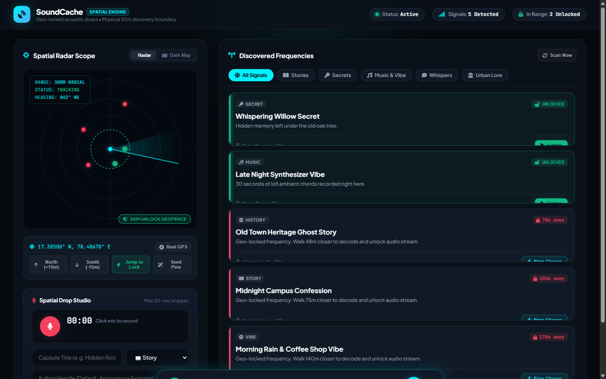
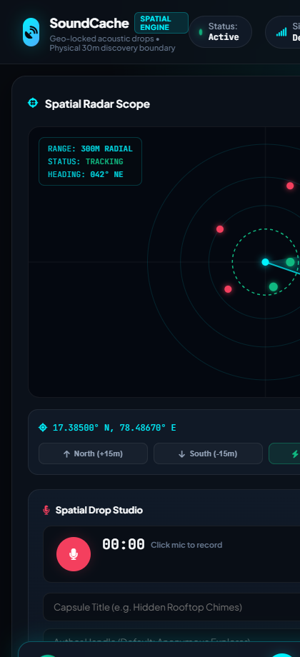

# SoundCache 🎧📍
> **Geo-Locked Audio Capsules (Digital Geocaching for Sound & Stories)**

SoundCache allows users to anchor voice notes, audio stories, secret confessions, acoustic vibes, or urban folklore to exact real-world GPS coordinates. Users exploring physical locations can only unlock and listen to these spatial voice drops when they walk within **30 meters** of the spot.

---

## 📸 Interface Previews

### Web Dashboard & Spatial Radar


### Mobile Device Interface
<p align="center">
  
</p>

---

## ⚡ Core Features

1. **Physical Discovery & Proximity Radar**:
   - Audio notes/capsules are anchored to real-world GPS coordinates (`latitude`, `longitude`).
   - If user is **> 30 meters** away: capsule is **LOCKED 🔒**. Audio is protected and cannot be decoded.
   - If user is **<= 30 meters** away: capsule **UNLOCKS 🔓**! Phone vibrates with haptic feedback, audio stream unlocks, and the player is revealed.
   - Live **Radar Sweep** visualization showing detected signals and relative positions.
   - **GPS Simulator Mode**: Built-in developer tool allowing you to take simulated steps (`+15m walk` or jump directly to nearest capsule) to test physical unlocking without needing to walk outside!

2. **Audio Drop Studio**:
   - Record up to 30-second spatial audio clips directly from device microphone using `expo-av`.
   - Real-time animated pulsing meter and countdown timer.
   - Audio preview playback before submitting.
   - Categorize by: `Stories`, `Secrets`, `Music & Vibe`, `Whispers`, `Urban Lore`.
   - Pins to the user's real-time GPS location.

3. **Capsule Player Modal**:
   - Cyberpunk obsidian & neon visual aesthetic.
   - Animated frequency soundwave visualizer synchronized to playback.
   - Scrub timeline with seconds counter.
   - Upvote / Like button (`POST /api/capsules/:id/like`).
   - Live listen counter (`POST /api/capsules/:id/listen`).

4. **Geospatial Backend REST API**:
   - Built with **Node.js, Express, MongoDB (Mongoose), and Multer**.
   - Uses MongoDB's **`2dsphere` spatial indexing** with `$near` and `$geometry` queries.
   - Resilient in-memory spatial fallback engine: runs out-of-the-box even before MongoDB is configured!
   - Auto-seed endpoint (`POST /api/capsules/seed`) to instantly drop capsules around any coordinates.

---

## 📂 Project Structure

```text
SoundCache/
├── api/                         # Node.js Express REST Backend
│   ├── models/
│   │   └── capsule.js           # Mongoose Schema with GeoJSON 2dsphere index
│   ├── uploads/                 # Static audio storage for recorded clips
│   ├── index.js                 # API server (nearby, drop, like, listen, seed)
│   ├── seed.js                  # Standalone capsule seeding script
│   └── package.json             # Backend dependencies
│
├── app/                         # Frontend Expo Router Pages
│   ├── _layout.js               # Root layout & theme configuration
│   └── (tabs)/
│       ├── _layout.js           # Bottom tab bar with neon radar icon
│       ├── index.js             # Radar screen (Explore, Radar Sweep, GPS Simulator)
│       ├── drop.js              # Drop Studio (Audio recording, preview, upload)
│       └── vault.js             # Frequency Vault (History, stats, API config)
│
├── components/                  # Reusable UI Components
│   ├── RadarSweep.js            # Animated radar ring with signal blips
│   ├── CapsuleCard.js           # Card with Locked/Unlocked state & distance
│   └── CapsulePlayerModal.js    # Unlocked audio player with soundwaves
│
├── utils/                       # Helpers & Business Logic
│   ├── api.js                   # REST API client with configurable base URL
│   ├── constants.js             # Theme colors, categories, 30m threshold
│   └── distance.js              # Haversine distance formula & formatters
│
├── app.json                     # Expo configuration with audio/GPS permissions
├── babel.config.js              # Babel Expo configuration
└── package.json                 # Frontend dependencies and npm scripts
```

---

## 🚀 Getting Started

### 1. Start the Backend API

From the project root:
```bash
# Start backend on http://localhost:3000
npm run server
```
Or navigate to `api/`:
```bash
cd api
npm start
```

### 2. Start the Frontend Mobile App

From the project root:
```bash
# Start Expo development server
npx expo start
```
- Press `a` to open in Android Emulator / device
- Press `i` to open in iOS Simulator
- Press `w` to open in Web Browser

---

## 📡 API Endpoints Reference

| Method | Endpoint | Description |
| :--- | :--- | :--- |
| `GET` | `/api/health` | Service status & storage mode |
| `GET` | `/api/capsules/nearby?lat=..&lng=..&maxDistance=..` | Find capsules near coordinates (computes distance & unlock status) |
| `GET` | `/api/capsules/all` | Fetch all capsules |
| `POST` | `/api/capsules` | Upload and drop a new capsule (`multipart/form-data`) |
| `POST` | `/api/capsules/:id/like` | Upvote a capsule |
| `POST` | `/api/capsules/:id/listen` | Increment listen counter |
| `POST` | `/api/capsules/seed` | Seed 5 demo capsules around specified lat/lng |

---

## 🧪 Testing the 30m Unlock Mechanism

1. Open the app on your device or simulator.
2. On the **Radar** tab, tap **"GPS Tool"** at the top right.
3. Tap **"Seed Near Me"** to scatter capsules within 15m to 200m of your position.
4. Capsules within 30m will show **`UNLOCKED`** with a green glow — tap to listen!
5. Capsules > 30m will show **`LOCKED 🔒`** — tap **"Walk Closer"** or use the **"+15m Walk"** button to simulate physical movement until the lock breaks!

